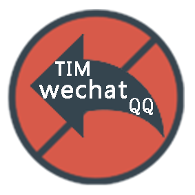
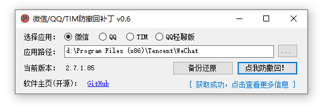

<p align="center">
	<a></a>
</p>
<p align="center">
	<a href="https://www.microsoft.com/download/details.aspx?id=30653">
		
	</a>
	<a href="https://github.com/huiyadanli/RevokeMsgPatcher/releases">
		
	</a>
	<a href="https://ci.appveyor.com/project/huiyadanli/RevokeMsgPatcher">
		
	</a>
</p>

# 👀微信/QQ/TIM防撤回补丁
适用于 Windows 下 PC 版微信/QQ/TIM的防撤回补丁。**支持微信/QQ/TIM**，其中微信能够选择安装多开功能。


下载地址：
**[⚡️点我下载最新版本](https://github.com/huiyadanli/RevokeMsgPatcher/releases/download/2.1/RevokeMsgPatcher.v2.1.zip)** |
[☁备用下载-蓝奏云](https://wwmy.lanzouq.com/b0fot7dpe)  密码:coco| 
[☁备用下载-百度云](https://pan.baidu.com/s/15ilr78t8F1-VW8eUZSkr_Q?pwd=3rrj) 

相关文档：
**[✔支持哪些版本](https://github.com/huiyadanli/RevokeMsgPatcher/wiki/%E7%89%88%E6%9C%AC%E6%94%AF%E6%8C%81)** | 
[❓常见问题](https://github.com/huiyadanli/RevokeMsgPatcher/wiki#%E5%B8%B8%E8%A7%81%E9%97%AE%E9%A2%98) | 
[📖查看完整文档](https://github.com/huiyadanli/RevokeMsgPatcher/wiki)

原理与方法：
[📗微信](https://github.com/huiyadanli/RevokeMsgPatcher/wiki/%E5%BE%AE%E4%BF%A1%E9%98%B2%E6%92%A4%E5%9B%9E%E4%B8%8E%E5%A4%9A%E5%BC%80%E6%95%99%E7%A8%8B) |
[📕QQ](https://github.com/huiyadanli/RevokeMsgPatcher/wiki/QQ%E6%88%96TIM%E9%98%B2%E6%92%A4%E5%9B%9E%E6%95%99%E7%A8%8B) |
[📘TIM](https://github.com/huiyadanli/RevokeMsgPatcher/wiki/QQ%E6%88%96TIM%E9%98%B2%E6%92%A4%E5%9B%9E%E6%95%99%E7%A8%8B)
**（本人不参与方法寻找，仅做特征搬运）**

附带产物：[一个通用的微信多开工具](https://github.com/huiyadanli/RevokeMsgPatcher/tree/master/RevokeMsgPatcher.MultiInstance)

## 📷截图


## 🔨使用方法

1. 首先，你的系统需要满足以下条件：

    * Windows 7 或更高版本，**不支持XP**。
    * [.NET Framework 4.5.2](https://www.microsoft.com/en-us/download/details.aspx?id=42642) 或更高版本。**低于此版本在打开程序时可能无反应，或者直接报错**。

2. 使用本程序前，先关闭微信/QQ/TIM。

3. **以管理员身份运行本程序**，等待右下角获取最新的补丁信息。

4. 选择微信/QQ/TIM的安装路径。如果你用的安装版的微信/QQ/TIM，正常情况下本程序会自动从注册表中获取安装路径，绿色版需要手动选择路径。

5. 点击防撤回。界面可能会出现一段时间的无响应，请耐心等待。**由于修改了微信的 WeChatWin.dll 文件、QQ/TIM的 IM.dll 文件，杀毒软件可能会弹出警告，放行即可。**

注意：微信/QQ/TIM更新之后要重新安装补丁！

## QQNT 9.9.33 / 微信 4.1.15 适配（2026-10-21）

以下 Windows x64 版本已完成文件特征及副本测试。表中的“通过”仅指静态匹配、补丁安装和还原验证。使用者另已反馈 QQ 和微信实际聊天防撤回有效；该反馈未细分群聊、私聊或消息类型，不能据此认定所有场景均已验收。

| 客户端 | 实际补丁文件版本 | 配置功能 | 已完成验证 |
| --- | --- | --- | --- |
| QQNT 9.9.33-51802 | `wrapper.node` 9.8.0.23849 | 群聊与私聊被动撤回拦截 | 两条特征均唯一匹配；副本安装、已安装识别、还原通过 |
| 微信 4.1.15.56 | `Weixin.dll` 4.1.15.56 | 防撤回、多开 | 两条特征均唯一匹配；副本安装、已安装识别、还原通过 |

### 使用与还原

1. 解压构建出的 `LocalCompat-*.zip` 到独立文件夹，保持 EXE、DLL 和配置文件在一起。使用下方脚本默认构建的包需要 **.NET Framework 4.8**。
2. 从系统托盘完全退出需要修改的 QQ 或微信，然后以管理员身份运行 `RevokeMsgPatcher.exe`。
3. 选择 **QQNT** 或 **微信4.0**（该选项也适用于 4.1）。程序从 32/64 位、当前用户/系统注册表，以及运行进程路径和常见目录发现安装位置；也可以手动输入客户端的安装根目录。
4. 检查显示版本和功能，再点击防撤回。微信多开可单独取消勾选。可选功能只在全部相关特征匹配时显示；已安装功能显示为已安装。部分安装或匹配失败时先还原，不能强制忽略校验。
5. 补丁成功后重新启动客户端。需要还原时，退出客户端后点击“还原”；请保留目标文件旁的 `.h.bak` 备份。新版微信修改的是版本子目录内 `Weixin.dll`，QQNT 修改的是 `versions\版本\resources\app\wrapper.node`。

程序会拒绝在 QQ/微信仍运行时安装或还原，不会自动结束客户端。修改先写入同目录临时文件，再原子替换目标；匹配失败、文件被占用或验证后发生变化时停止写入。自动更新后需要重新检查版本，旧备份不能用于新版本。

### 适配实现与边界

- `PathUtil` 同时读取两种注册表视图和用户/系统安装信息，正确处理带引号、参数的卸载路径；默认路径搜索也包含各盘 `app\Tencent`。代码没有固定安装盘符。
- 微信允许选择安装根目录、版本目录或 EXE；有启动器时以其文件版本定位活动目录，否则按数字版本选择包含 `Weixin.dll` 的目录，避免目录时间戳误导。
- QQNT 支持安装根目录、版本目录和 `resources\app`。选择最高且包含目标文件的有效版本目录，忽略下载未完成的目录；界面同时显示目录版本与模块版本。QQ 启动器与模块版本可能不同，补丁始终匹配实际模块版本。若保留多个完整版本且需要处理旧版，请手动选择对应版本目录。
- QQ 新规则只适用模块版本 **9.8.0.23849**：群聊特征起点文件偏移 `0x2618B5E`，修改 `0F 87` 为 `0F 86`；私聊特征起点 `0x2615CED`，将 `[Msg] on c2c recall nfy!` 日志后 `HandleRecallMsgNotify` 对应的 `CALL`（文件偏移 `0x2615CFB`，目标 RVA `0x26171F8`）替换为 5 个 NOP，并保留参数清理。两条规则属于同一功能，必须同时唯一匹配。
- 该 QQ 规则没有移植旧版针对主动撤回、本地删除回调和拍一拍的额外修改。离线同步、拍一拍、自撤回、图片及文件保留等场景未验收，不承诺完整覆盖。
- `ReplacePattern.ExpectedMatches` 为可选整数，默认 `0` 保持旧规则的“一次或多次”；正数要求精确次数。上述 QQ 规则与新版微信规则为 `1`。匹配按每条规则校验，拒绝遗漏、歧义和重叠修改；所有规则均已替换才标记该功能已安装。
- 保留原项目的旧客户端配置；修复 QQNT 在线补丁信息更新时未刷新配置的问题。界面下载到更新的上游规则后可能改变适配结果，安装前仍会重新检查实际文件。

### 开发、构建与验证

安装 Visual Studio Build Tools 的 .NET 桌面构建工作负载与 .NET Framework 4.8 目标包。在仓库根目录使用 **Windows PowerShell**，并将客户端路径示例替换为实际安装路径：

```powershell
# 构建全部项目、生成并嵌入补丁数据、运行回归测试、打包。
powershell.exe -NoProfile -ExecutionPolicy Bypass -File .\tools\Build.ps1

# 额外读取指定安装文件，在临时副本上执行安装和还原，并输出核验报告。
powershell.exe -NoProfile -ExecutionPolicy Bypass -File .\tools\Build.ps1 `
  -QQPath 'C:\Program Files\Tencent\QQNT' -WeixinPath 'C:\Program Files\Tencent\Weixin'

# 已构建时，只读检查安装文件（临时回归夹具仍会创建和清理）。
.\RevokeMsgPatcher.Tests\bin\Release\RevokeMsgPatcher.Tests.exe --probe `
  'C:\Program Files\Tencent\QQNT' 'C:\Program Files\Tencent\Weixin' '.\artifacts\compatibility-report.json'
```

`tools\Build.ps1` 默认 `TargetFrameworkVersion=v4.8`，需要对应目标包；缺少目标包会报 MSB3644。主项目原有框架目标保持不变；有完整旧目标包时可传 `-TargetFrameworkVersion v4.5.2`，该配置尚未验证。构建失败或测试失败不会生成新发布包。发布包位于 `artifacts\LocalCompat-*`，包含 README、许可证、SHA256 清单及本次可选核验报告；报告明确区分文件验证与未执行的聊天测试。

补丁数据的维护源是 `RevokeMsgPatcher.Assistant\JsonData.cs`。构建脚本通过 `tools\Update-PatchResources.ps1` 调用它的序列化方法，同步 `Data\2.1\patch.json` 和主程序内嵌 `PatchJson`；回归测试检查两者一致，避免只更新 JSON 而 EXE 继续使用旧规则。

在上述版本上已执行 31 项检查：规则同步、EOF 通配匹配、缺失规则/重复命中/重叠修改拒绝、已安装状态、只读哈希、文件变化和锁定保护、版本目录选择，以及 QQ/微信真实文件副本的安装和还原。CI 在 Debug/Release 构建后运行无需安装客户端的回归检查；指定客户端路径时另行执行副本验证。两份安装文件的 SHA256、文件属性与修改时间均保持不变。原项目仍有一条 `getPatchJsonStatus` 未使用的编译警告。

| 验证样本 | SHA256 |
| --- | --- |
| QQNT `wrapper.node` | `929b59467fdd84f6ff24a4f384347501339c9739244d45f18015e4a925a412b9` |
| 微信 `Weixin.dll` | `e0428a7b691853de496532523c2c09aa095f90941c37c9f4cfb3f137f3c66556` |

指定客户端路径的检查支持未安装及已安装补丁的状态；已安装时必须保留同版本且匹配原始特征的 `.h.bak`，用于复制到临时目录测试。原文件和备份都不被修改。

实际聊天的完整验收还需分别覆盖 QQ 私聊、QQ群与微信，并检查主动撤回、重启、图片、文件及多开。上述自动化检查不会发送消息，也不会修改安装目录中的文件；报告中的 `RuntimeRecallTested=false` 仅表示自动化程序没有执行聊天测试，与使用者反馈分开记录。

## 💡致谢

本项目早期内容源自 [wechat_anti_revoke](https://github.com/36huo/wechat_anti_revoke) 项目。

2.0 之前版本 QQNT 防撤回依赖于 [LiteLoaderQQNT](https://github.com/LiteLoaderQQNT/LiteLoaderQQNT)，修补依赖于 [DLLHijackMethod](https://github.com/LiteLoaderQQNT/QQNTFileVerifyPatch/tree/DLLHijackMethod) 并集成了以下插件：

* [插件列表查看 LL-plugin-list-viewer](https://github.com/ltxhhz/LL-plugin-list-viewer)
* [防撤回 LiteLoaderQQNT-Anti-Recall](https://github.com/xh321/LiteLoaderQQNT-Anti-Recall)

2.1 版本的 QQNTT 防撤回特征来自 [NTQQAntiRecall]( https://github.com/NapNeko/NTQQAntiRecall)

微信4.0版本后的防撤回特征来自于 [BetterWX](https://github.com/zetaloop/BetterWX)

## ❤️投喂

觉的好用的话，可以支持作者哟ヾ(･ω･`｡) 
* [⚡爱发电](https://afdian.com/@huiyadanli)
* [🍚微信赞赏](https://github.com/huiyadanli/huiyadanli/blob/master/DONATE.md)

## 📄License
[GPLv3](https://github.com/huiyadanli/RevokeMsgPatcher/blob/master/LICENSE)


